<div align="center">



</div>

```text
> NEO-TOKYO NET v2.019 ............ ok
> carregando perfil: dev.fullstack  ok
> stack: .NET | React | Next.js | RN ok
> acesso liberado.
```


## SOBRE · アクセス許可

Sou desenvolvedor **fullstack júnior**. No back-end trabalho com **.NET Framework**, C#, ASP.NET e SQL Server. No front, uso **React** e **Next.js**. No mobile, **React Native**.

Gosto de ver uma ideia sair do banco de dados e chegar funcionando na mão de quem usa. Agora estou migrando meu conhecimento do .NET Framework para o **.NET moderno**.

```text
┌─ FICHA DO DESENVOLVEDOR ──────────────────────┐
│ NOME     Eder Oliveira                        │
│ FUNÇÃO   Dev Fullstack Jr                     │
│ BASE     Brasil                               │
│ FOCO     .NET · React · Next.js · Mobile      │
│ STATUS   ONLINE — aberto a projetos          │
└───────────────────────────────────────────────┘
```


## STACK · システム

**BACK-END**


**FRONT-END**


**MOBILE**


**FERRAMENTAS**


## PROJETOS · ファイル

| ARQUIVO | DESCRIÇÃO | STACK | LINKS |
| :-- | :-- | :-- | :-- |
| **01 · Kaneda ERP** | Sistema web de gestão para pequenas empresas: clientes, pedidos, estoque e relatórios. | C# · .NET Framework · ASP.NET MVC · SQL Server | [Código](#) · [Demo](#) |
| **02 · Neo Shop** | Loja online com catálogo, carrinho e checkout. O front em Next.js consome uma Web API em .NET. | Next.js · React · TypeScript · Web API | [Código](#) · [Demo](#) |
| **03 · Capsule App** | App para iOS e Android com login, listas e notificações, ligado à mesma API. | React Native · Expo · TypeScript | [Código](#) · [Vídeo](#) |

<!-- Opcional: cartões de estatísticas. Troque SEU-USUARIO pelo seu usuário do GitHub. -->
<p align="center">
  
  
</p>


## CONTATO · 連絡

Aberto a vagas, freelas e projetos em .NET, web e mobile.

[](mailto:seu@email.com)
[](https://linkedin.com/in/seu-usuario)
[](https://seu-portfolio.com)

<div align="center">

```text
> FIM DA TRANSMISSÃO.
```

</div>